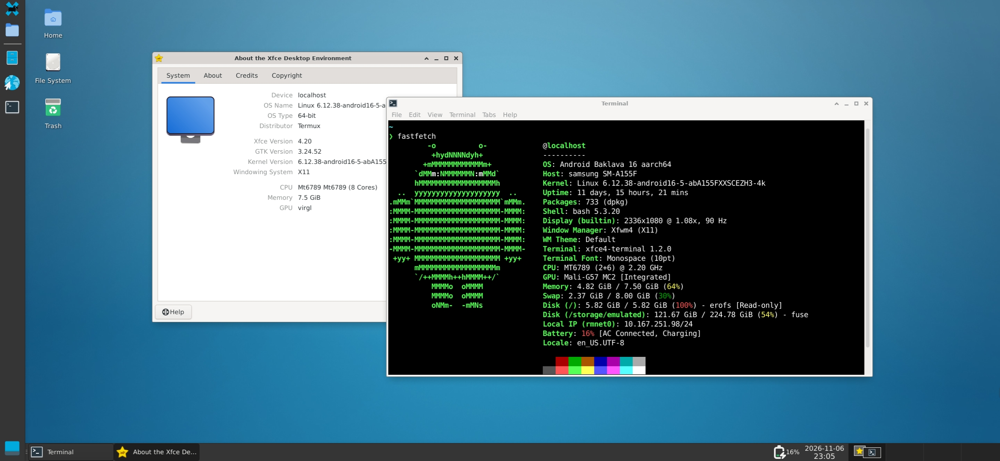
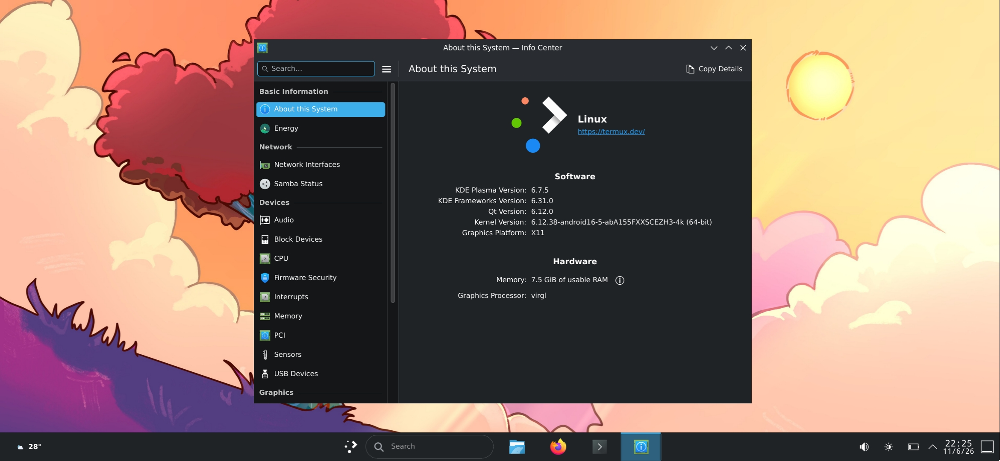

# 🛠 "REPOSITORY STILL IN PROGRESS"

# Termux-Android

Termux is a Linux terminal environment, you can connect server via SSH, programing using Nano, Vim, and any terminal-based apps.

Working on desktop environment: coding with VS Code, LibreOffice for office work, and other applications. (Note that not all Applications support Termux.)

For the desktop, i recommend you to use XFCE4, also you can choose KDE Plasma as your main desktop, or both, but, KDE Plasma is a little heavier than XFCE4.

(OPTIONAL) running Arch Linux ARM64 PRoot with KDE Plasma or XFCE4 desktop, (I only know two DE installation for Arch Linux.) or other Linux Distros on proot-distro for many apps support compared to Termux native.

### You can visit the official [DroidMaster repository](https://github.com/LinuxDroidMaster/Termux-Desktops?tab=readme-ov-file) for more installation details and information.
<br>
<br>

## Requirement:
* 5 GiB of free storage.
* Termux F-Droid or GitHub version. (not from Play Store.)
* Termux:X11 for graphical user interface.

<br>
<br>

## Installation:
Install Termux, setup Termux and XFCE4 or Plasma using script, running desktop on Termux:X11. Instruction below⬇️

<br>
<br>

# 📚 Index
* 🏁 [First steps](#first-steps)
* 💻 [Setup with script](#setup-termux)
* 📋 [Shortcut list](#shortcuts-menu)

<br>
<br>

---
<br>


# Termux Environment Preview

| XFCE4 | KDE Plasma |
|---------------------------------------------|---------------------------------------------|
|  |  |


---
<br>
<br>


# 🏁 First <a name=first-steps></a>
you need to install:

* [Termux F-Droid](https://f-droid.org/packages/com.termux) (not the beta version.)
* [Termux:X11](https://github.com/termux/termux-x11/releases/tag/nightly) universal debug apk.

in order for a full Linux desktop.

⚠️ Do not install Termux from Play Store!

Update package and install wget:

```
pkg update && pkg install wget
```

<br>
<br>

---
<br>

# 💻 Setup Termux and the desktop using script<a name=setup-termux></a>
Download the script, give permission, and execute:
```
wget https://raw.githubusercontent.com/MopikuAveely/Termux-Android/refs/heads/main/scripts/Termux_setup/termux_setup.sh && chmod +x termux_setup.sh && ./termux_setup.sh
```
If the script stop with errors, check and run it again:
```
./termux_setup.sh
```
After finished, to apply the change, please login-out and login-in.
* press (CTRL + D) to logout.

<br>
<br>

---
<br>

# 📋 Shortcuts menu:<a name=shortcuts-menu>
<table>
  <thead>
    <tr>
      <th scope="col" colspan="6">Execute it on your Termux</th>
    </tr>
    <tr>
        <th scope="col">Shortcuts:</th>
        <th scope="col">Information:</th>
    </tr>
  </thead>
  <tbody>
    <tr>
      <td>xfceD</td>
      <td>To start XFCE4 desktop.</td>
    </tr>
    <tr>
      <td>kdeD</td>
      <td>To start KDE Plasma desktop.</td>
    </tr>
    <tr>
      <td>killx11</td>
      <td>To force-close X11 server. </td>
    </tr>
  </tbody>
<table>

⚠️ Shortcut 'killx11' can potentially damages your application's data if there still running on X11, so be careful.

Don't run multiple desktop launchers at the same time, it's just like 'killx11' that force-close X11 server to make the new one.
  
<br>
<br>

---
<br>

# 4🛠
